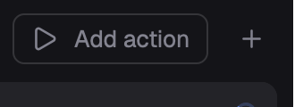

# Actions for Herdr App

English · [中文](README.zh-CN.md)

A [Herdr App](https://herdr.dev) mod with [T3 Code](https://github.com/pingdotgg/t3code)-style actions: commands you run with one click from your top bar. `▶` runs the action you ran last, `▾` lists them all (click one to run it), with a gear to edit each and Add action. Each action is a command run in a new tab, or split right/down, in the focused terminal's folder or its own. Edited in the app, not in a file.



It is the Actions control of the [Herdr T3 layout](https://github.com/JinJieBeWater/herdr-t3), on its own.

## Install

Ask your Herdr agent to add `herdr.dev/mods/JinJieBeWater/herdr-t3-actions`, or copy `mods/t3-actions/` into `~/.config/herdr-app/mods/`. Then put it in your layout's top bar: a block in a `row` with `"resizable": false`, the block's own `id` in `props.block`. The control sizes that block to itself:

```json
{ "id": "actions", "type": "block", "size": { "px": 108 }, "window_drag": true,
  "content": { "mod": "t3-actions", "props": { "block": "actions" } } }
```

Herdr T3 already has it. Without `props.block` the block keeps the size the layout gives it.

## Update

Herdr doesn't update mods from others, and adding this again would install a renamed second copy, since an install never overwrites. Overwrite `mods/t3-actions/` with the repo's latest instead (tell your Herdr agent, or copy the files), then run `herdr-app check` on it. Your actions are kept: they live in `shared.json` (under `t3-actions`).

## What it runs

Only the commands you save, each through `sh -c` in a new terminal (`terminal.open`): your shell's aliases and functions aren't there (write `zsh -ic '…'` in the command for them), and plain Windows has no `sh`. No network, no files outside its folder.

## Develop

`node mods/t3-actions/check.cjs` runs the mod without a window; `herdr-app check mods/t3-actions` loads it in Herdr.

## License

Apache-2.0, as Herdr App.
