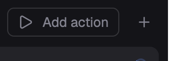

# Herdr App 的动作按钮

[English](README.md) · 中文

一个 [Herdr App](https://herdr.dev) mod，做的是 [T3 Code](https://github.com/pingdotgg/t3code) 那样的动作：在顶栏一键运行的命令。`▶` 运行上次用过的动作，`▾` 列出全部动作（点一个就运行），每项有齿轮可编辑，底部可 Add action。每个动作是一条命令，在新标签或右/下分屏里运行，目录默认用当前终端的，也可以单独指定。在界面里编辑，不用改文件。



它就是 [Herdr T3 布局](https://github.com/JinJieBeWater/herdr-t3)里的动作控件，单独拿出来。

## 安装

让你的 Herdr agent 添加 `herdr.dev/mods/JinJieBeWater/herdr-actions`，或者把 `mods/herdr-actions/` 复制进 `~/.config/herdr-app/mods/`。然后放进布局的顶栏：放在一个 `"resizable": false` 的 `row` 里，块自己的 `id` 写进 `props.block`。控件会把这个块调整到自己的宽度：

```json
{ "id": "actions", "type": "block", "size": { "px": 112 }, "window_drag": true,
  "content": { "mod": "herdr-actions", "props": { "block": "actions" } } }
```

Herdr T3 里已经放好了。没有 `props.block` 时，块保持布局给的宽度。

## 更新

Herdr 不会更新别人做的 mod，再添加一次只会装出一份改了名的副本，因为安装从不覆盖。更新要用仓库最新的文件覆盖 `mods/herdr-actions/`（让 Herdr agent 做，或者手动复制），再对它跑 `herdr-app check`。你的动作会保留：它们存在 `shared.json` 里（`t3-actions`，沿用在 Herdr T3 时的名字）。

## 会运行什么

只运行你保存的命令，每条都通过 `sh -c` 在新终端里运行（`terminal.open`）：拿不到你 shell 的别名和函数（需要的话在命令里写 `zsh -ic '…'`），纯 Windows 也没有 `sh`。不联网，也不读写自己目录以外的文件。

## 开发

`node mods/herdr-actions/check.cjs` 不开窗口就能跑通这个 mod；`herdr-app check mods/herdr-actions` 在 Herdr 里加载它。

## 许可

Apache-2.0，与 Herdr App 相同。
