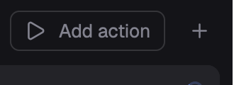

# Actions

T3 Code's run button for Herdr App's top bar: `▶ <name> | ▾` runs the action you ran last with one click, its menu runs any other, and an editor adds and changes them. Each action is a command, run in a new terminal tab or split.

## Where it's specified

`mods/t3-actions` is the [Herdr T3 layout](https://github.com/JinJieBeWater/herdr-t3)'s, copied here by its `scripts/sync.sh`. Its look and behaviour (the control, the menu, the editor and its confirm dialog) are herdr-t3's [dialogs spec](https://github.com/JinJieBeWater/herdr-t3/blob/main/docs/internals/specs/dialogs.md#actions) and [visual tokens](https://github.com/JinJieBeWater/herdr-t3/blob/main/docs/internals/t3-tokens.md); change it there. What follows is only how it differs on its own.

## On its own

- `mod.json` places it nowhere (`"place": "none"`): a layout puts it in a top-bar block, `{ "mod": "t3-actions", "props": { "block": "<the block's id>" } }`, in a row with `"resizable": false`. It sizes that block itself (`layout.resize` with `props().block`), so the row mustn't be dragged.
- Without Herdr T3's bar nothing sets `shared("t3-tabs.compact")`: the control always shows its words.
- Running is `terminal.open { argv: ["sh", "-c", command], name, place, folder? }`, in the focused terminal's folder when the action names none. Actions live in `shared("t3-actions.actions")`, which Herdr keeps across restarts.

## Watch out

- `layout.resize` doesn't reach a block in a floating window's layout: there the block keeps its size.
- Commands run through `sh -c`: your shell's aliases and functions aren't there, and plain Windows has no `sh`.

## Done when

- `node mods/t3-actions/check.cjs` prints `ok`; `herdr-app check mods/t3-actions` passes.
- With no actions the block shows `▶ Add action`, exactly as wide as the control plus 8px; adding one through the editor shows `▶ <name> | ▾` and the block grows to fit it.
- `▶` opens a tab named after the action running its command; a menu row runs that one and makes it the one `▶` runs.
