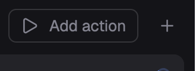

# Actions

T3 Code's run button for Herdr App's top bar: `▶ <name> | ▾` runs the action you ran last with one click, its menu runs any other, and an editor adds and changes them. Each action is a command, run in a new terminal tab or split.

## What you see

- **Control** (`herdr-actions` in a top-bar block, 26px tall, centered in the bar's height): one 1px `border` outline, radius 6, 12px `dim` text. With actions: the primary action's 14px icon and its name (140px max, truncated), 8px each side, then a 1×14px `border` rule, then a `chevron-down` (14px, 5px each side). With none: a 14px play icon and `Add action`, 8px each side. No fill at rest; a part hovered fills `hover` to the outline, its icon and text `foreground`, and has a hover label, as Herdr T3's. 8px after it, before what follows in the bar.
- **Menu** (this mod with props `{ "actions": "menu" }`, a 280px popup hanging from the bar under the click, at y 40): one 32px row per action (icon, name, a gear on the right), a divider, then `+ Add action`.
- **Editor** (props `{ "actions": "edit", "id" }`, a 440×410 dialog): Name, Command and Folder (optional) inputs; Icon (play, test, lint, configure, build, debug: lucide's play, flask-conical, list-checks, wrench, hammer, bug, as T3 Code) and Run in (Tab, Right, Down) choices; Delete (when editing; asks through the shipped `confirm`, which answers with `herdr-actions.delete-action:<id>`), Cancel, Save (needs a name and a command; Enter in an input saves).

## How it behaves

- As T3 Code's project actions but global: the primary action is the one run last, else the first. `▶` runs it; a menu row runs that action and makes it primary; the gear opens the editor.
- Running is `terminal.open { argv: ["sh", "-c", command], name, place, folder? }`: a new tab or a split right/down every time, named after the action; the shell stays when the command ends. With no folder it starts in the focused terminal's folder; with a mod pane focused, a terminal's in the same tab, else the space's; `~` is expanded.
- Actions live in `shared("t3-actions")` = `{ list: [{ id, name, command, icon, place, cwd? }], last }`, which Herdr keeps across restarts.

## Built from

- `mods/herdr-actions/main.js`: one mod, three roles by `props().actions`: none (the control), `"menu"`, `"edit"`; the control opens the other two with `openOverlay({ mod: "herdr-actions", … })`.
- It sizes its own block: `on_size_change` on a `flex_none` wrapper (the control and its 8px) reports its full width even when the block is narrower; divided by `settings().zoom` (it reports zoomed pixels), it goes to `run("layout.resize", { id: props().block, px })`, only when it changed. Herdr keeps that size with the layout's clicks.
- With `shared("bar.compact")` true (Herdr T3's bar sets it under 1024px; unset elsewhere), the control drops its text: `▶`, or `▶ | ▾`. Hover labels and accessibility labels keep the names.
- Icons: `mods/herdr-actions/action-*.svg` (lucide), Herdr's `mods/workspace-chrome/chevron-down.svg`, `settings.svg`, `plus.svg`.

## Watch out

- A hover style's color reaches text but never an svg: the control brightens its icon by state (`on_hover`), not by `.hover()`.
- The menu's popup is placed under the press (`e.position`, window coordinates) at y `40 × zoom`, the bar's height; with no press (assistive tech), at the pointer.
- `layout.resize` doesn't reach a block in a floating window's layout. The block's row needs `"resizable": false`: rows default to resizable, and a drag would fight the block sizing itself.
- Commands run through `sh -c`: your shell's aliases and functions aren't there, and plain Windows has no `sh`.

## Done when

- `node mods/herdr-actions/check.cjs` prints `ok`; `herdr-app check mods/herdr-actions` passes.
- With no actions the block shows `▶ Add action`, exactly as wide as the control plus 8px; adding one through the editor shows `▶ <name> | ▾` and the block grows to fit it.
- `▶` opens a tab named after the action running its command; a menu row runs that one and makes it the one `▶` runs.
